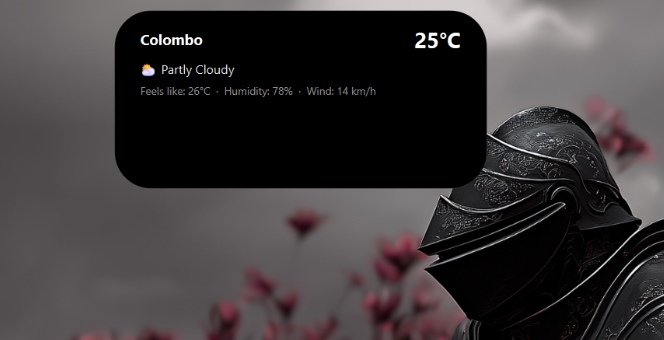
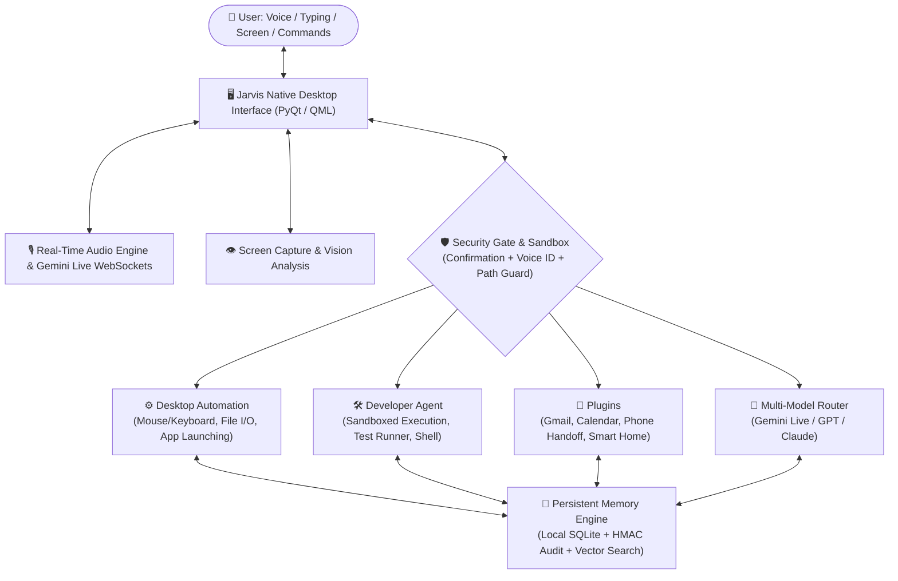

<div align="center">

# ⚙️ JARVIS AI
### The Autonomous Multimodal Personal AI Desktop Operating Layer

[](https://www.python.org/)
[](LICENSE)
[](LICENSE)
[](https://github.com/Sh3hann/Jarvis-AI)
[](https://ai.google.dev/)
[](https://github.com/Sh3hann)

<br/>

> **"Hear. See. Speak. Think. Act."**
>
> *Jarvis AI is a fully autonomous, cross-platform personal AI operating layer that runs natively on your machine. Combining low-latency voice streaming, real-time vision understanding, persistent memory, deep desktop automation, developer tooling, and phone communication into a unified companion.*

**⚡ Zero Subscriptions • 🔒 100% Local Configuration • 🛡️ Zero Cloud Telemetry • 💻 Your Computer, Your AI**

---

</div>

> [!CAUTION]
> ### 🛑 STRICT LEGAL & OWNERSHIP NOTICE: NON-COMMERCIAL USE ONLY
> **This software is licensed under the Creative Commons Attribution-NonCommercial 4.0 International License (CC BY-NC 4.0).**
> - **CANNOT BE SOLD**: You **CANNOT** sell, resell, lease, sublicense, commercialize, or charge any fees for this software, its source code, compiled binaries, or derivative works under any circumstances.
> - **NO COMMERCIAL PACKAGING OR BUNDLING**: You cannot bundle Jarvis AI into paid commercial hardware units, software packages, or paid courses.
> - **NO PAID SAAS OR CLOUD HOSTING**: You cannot host this project as a paid cloud platform or paid API service.
> - **FULL SOLE OWNERSHIP**: All architectural rights, codebases, and intellectual property belong exclusively to **[Sh3hann](https://github.com/Sh3hann)**. Any permitted personal or educational redistribution must prominently retain all copyright notices, license terms, and attribution to **Sh3hann**.

---

## 📑 Table of Contents

- [✨ What is Jarvis AI?](#-what-is-jarvis-ai)
- [🏝️ Dynamic Island Desktop Experience](#️-apple-ios-dynamic-island-desktop-experience)
- [🏛️ System Architecture](#️-system-architecture)
- [🚀 What Can Jarvis Do? (Comprehensive Features)](#-what-can-jarvis-do-comprehensive-features)
  - [🎙️ Real-Time Voice & Speech Engine](#️-real-time-voice--speech-engine)
  - [👁️ Vision & Screen Intelligence](#️-vision--screen-intelligence)
  - [🖥️ Autonomous Computer Automation](#️-autonomous-computer-automation)
  - [🧠 Persistent Hierarchical Memory](#-persistent-hierarchical-memory)
  - [🛠️ Developer Agent & Sandbox](#️-developer-agent--sandbox)
  - [🔌 Extensible Plugin Ecosystem](#-extensible-plugin-ecosystem)
  - [🛡️ Zero-Trust Security Gate](#️-zero-trust-security-gate)
- [⚡ Complete Installation & Setup Guide](#-complete-installation--setup-guide)
  - [1. System Prerequisites](#1-system-prerequisites)
  - [2. Clone the Repository](#2-clone-the-repository)
  - [3. Environment Setup](#3-environment-setup)
  - [4. Install Dependencies & Playwright](#4-install-dependencies--playwright)
  - [5. Run Jarvis](#5-run-jarvis)
- [🔑 Configuration & Safe Credential Setup](#-configuration--safe-credential-setup)
- [⚠️ Limitations & Boundaries](#️-limitations--boundaries)
- [📸 Showcasing & Social Media Tagging Policy](#-showcasing--social-media-tagging-policy)
- [💬 Feedback, Feature Requests, Updates & Bug Reports](#-feedback-feature-requests-updates--bug-reports)
- [⚖️ License & Ownership](#-license--ownership)

---

## ✨ What is Jarvis AI?

Most AI tools are confined to browser tabs or stateless chat boxes. **Jarvis AI** changes this paradigm by functioning as an **autonomous operating layer directly on your operating system**:

1. **Native OS Presence**: Runs locally on Windows, macOS, or Linux with a responsive desktop HUD interface.
2. **True Multimodal Sensory Awareness**: Listens to microphone audio in real time, inspects active desktop screens, and interfaces with webcams on demand.
3. **Autonomous Hands-On Execution**: Controls applications, automates keyboard and mouse interactions, runs shell scripts, manages files, and navigates websites.
4. **Persistent Long-Term Memory**: Automatically stores facts, habits, preferences, and session reflections in a local SQLite database so it remembers you across days and weeks.
5. **Privacy First**: Sensitive credentials, personal memories, and local files remain strictly isolated on your local computer.

---

## 🏝️ Apple iOS Dynamic Island Desktop Experience

JARVIS features an authentic **Apple iOS Dynamic Island** floating desktop interface engineered with true OLED black (`#000000`), frosted borders, and live micro-animations:

<div align="center">

### 1. Minimalist Dynamic Island Pill (Compact Mode)


*Always-on-top floating OLED pill seamlessly integrated into your desktop.*

<br/>

### 2. Expanded Dynamic Island Card (Live Weather & Telemetry)


*Interactive expanded card with live weather, humidity, system status, and media controls.*

</div>

---

## 🏛️ System Architecture



---

## 🚀 What Can Jarvis Do? (Comprehensive Features)

### 🎙️ Real-Time Voice & Speech Engine
- **Low-Latency Gemini Live Streaming**: Connects directly to Google's Gemini Live API over bi-directional WebSockets for lightning-fast, ultra-natural spoken dialogues.
- **Offline Wake-Word Detection**: Listens locally for `"Hey Jarvis"` without transmitting background audio to cloud servers.
- **Live Spoken Interruption**: Speak over Jarvis while he is answering to instantly halt his speech and issue a new instruction.
- **Biometric Voice ID**: Locks sensitive commands and spoken confirmations to your unique voice signature using native OS credential vaults (Windows DPAPI, macOS Keychain, Linux Secret Service).
- **Customizable Voices & Personalities**: Select between multiple Gemini voice profiles (Puck, Charon, Aoede, Fenrir, Kore) and adjust response styles.

### 👁️ Vision & Screen Intelligence
- **Live Desktop Window Inspection**: Ask Jarvis to inspect your code, an error message, a spreadsheet, or an article currently open on your monitor.
- **Document & Image Analysis**: Summarize and extract information from PDFs, documents, screenshots, and visual charts.
- **Webcam Support**: Point objects or notes to your webcam for real-time visual assistance.

### 🖥️ Autonomous Computer Automation
- **Application Control**: Open, focus, switch, and close software on your computer (VS Code, Chrome, Spotify, Calculator, etc.).
- **Smart Mouse & Keyboard Automation**: Click buttons, fill forms, and trigger keyboard shortcuts autonomously.
- **File System Management**: Search for files, organize directories, read file contents, and clean up workspace folders.
- **Web Browsing**: Launch headless or headed browser sessions to search Google, extract articles, and automate repetitive online tasks.
- **Media Controls**: Control YouTube and Spotify playback with simple voice commands.

### 🧠 Persistent Hierarchical Memory
- **Episodic, Semantic & Autobiographical Store**: Remembers your name, favorite tools, coding conventions, project details, and preferences.
- **Local SQLite Engine**: All memories are stored in a local encrypted database on your hard drive (`memory/long_term.db`).
- **Memory Reflection & Consolidation**: Consolidates daily interactions into structured insights and key learnings.
- **Full Privacy & Inspection**: Inspect, edit, export, or wipe memory records anytime.

### 🛠️ Developer Agent & Sandbox
- **Autonomous Coding & Debugging**: Generate scripts, write unit tests, and resolve code syntax errors.
- **Process-Containment Sandbox**: Runs generated code inside a monitored temporary environment with memory caps, timeout terminations, and stripped environment variables.
- **Self-Healing Diagnostics**: Inspects system health, checks missing dependencies, and runs approval-gated repair routines.

### 🔌 Extensible Plugin Ecosystem
- **Google Workspace Integration**: Read, search, and draft emails with Gmail; inspect, schedule, and update events on Google Calendar.
- **Phone Handoff & Voicemail**: Integrates with Twilio to answer phone calls, converse with callers, and transcribe voicemails directly to your desktop.
- **Smart Home & IoT**: Command smart lighting, switches, and smart home appliances via Tuya and MQTT protocols.
- **Interactive Quizzer**: Spoken quizzes across any topic to help you learn and test your knowledge.

### 🛡️ Zero-Trust Security Gate
- **Approval-Gated Sensitive Operations**: Deleting files, modifying system settings, sending emails, or running arbitrary shell commands always require explicit user confirmation.
- **Tamper-Evident HMAC Audit Ledger**: Every action, tool call, and confirmation is logged into a cryptographically hashed ledger (`security/audit_log.jsonl`).
- **Path Guard**: Blocks AI models from accessing sensitive paths (e.g., `.ssh`, `config/api_keys.json`).

---

## ⚡ Complete Installation & Setup Guide

### 1. System Prerequisites
- **Operating System**: Windows 10/11, macOS (12+), or Linux (Ubuntu 20.04+, Debian, Fedora).
- **Python Version**: `3.11` to `3.13` (Recommended: **Python 3.12**).
- **Hardware**: Working microphone and speakers/headphones; webcam optional.
- **Git**: Installed and available in your terminal path.

---

### 2. Clone the Repository

Open your terminal or command prompt and clone the repository:

```powershell
git clone https://github.com/Sh3hann/Jarvis-AI.git
cd Jarvis-AI\JarvisAI
```

---

### 3. Environment Setup

Create an isolated virtual environment to keep your dependencies clean:

#### Windows (PowerShell):
```powershell
python -m venv .venv
.\.venv\Scripts\Activate.ps1
```
*(If PowerShell blocks script execution, run: `Set-ExecutionPolicy -Scope Process -ExecutionPolicy Bypass`)*

#### macOS / Linux:
```bash
python3 -m venv .venv
source .venv/bin/activate
```

---

### 4. Install Dependencies & Playwright

Install all core Python libraries:

```powershell
python -m pip install --upgrade pip
pip install -r requirements.txt
```

*(Optional: For web automation features, install Playwright browser binaries)*:
```powershell
python -m playwright install
```

---

### 5. Run Jarvis

Once installed and configured (see [Configuration & API Keys](#-configuration--safe-credential-setup) below), start Jarvis:

```powershell
python main.py
```

*On Windows, you can also launch Jarvis by simply double-clicking [`run_jarvis.bat`](file:///f:/Jarvis-AI-main/Jarvis-AI-main/JarvisAI/run_jarvis.bat).*

---

## 🔑 Configuration & Safe Credential Setup

Jarvis uses local configuration files that are **automatically ignored by `.gitignore`** to ensure your credentials never leak.

### 1. Configure Core API Keys

Copy the example configuration template:
```powershell
Copy-Item config\api_keys.example.json config\api_keys.json
```
*(On macOS/Linux: `cp config/api_keys.example.json config/api_keys.json`)*

Open `config/api_keys.json` in your favorite editor and add your Gemini API Key:
```json
{
    "gemini_api_key": "YOUR_GEMINI_API_KEY_HERE",
    "os_system": "windows",
    "ai_provider": "gemini",
    "assistant_name": "JARVIS"
}
```

> [!TIP]
> Get a free Gemini API key from [Google AI Studio](https://aistudio.google.com/).

### 2. Optional Integrations

- **Google Workspace (Gmail & Calendar)**:
  Copy `config/google_credentials.example.json` to `config/google_credentials.json` and insert your OAuth Client ID & Secret from Google Cloud Console.
- **Telephony & Twilio**:
  Add your Twilio credentials to `config/api_keys.json` or `.env` to enable live incoming phone call handling.

---

## ⚠️ Limitations & Boundaries

While Jarvis AI is powerful, please keep the following operational constraints in mind:

1. **Active Internet Connection Required**: Real-time voice streaming with Gemini Live and web searches require an active internet connection. Offline wake-word detection works locally, but dialog reasoning requires the network.
2. **Process Containment vs. Virtual Machine**: The developer sandbox provides best-effort process isolation (memory limits, timeout kills, and temp folders). It is **not** a full hardware-virtualized container (like Docker or a VM). Exercise standard caution when running untrusted scripts.
3. **API Rate Limits**: Requests are subject to your provider's API limits and quotas (e.g. Gemini free-tier rate limits or OpenSky radar limits).
4. **Hardware Latency**: Audio performance depends on microphone quality, input noise levels, and internet latency. Using a headset minimizes audio feedback and echo.
5. **Operating System Privileges**: Jarvis runs with the privileges of the executing user account. Avoid running Jarvis as an elevated Administrator / Root user.

---

## 📸 Showcasing & Social Media Tagging Policy

Building something cool with Jarvis AI? Created a custom setup or recorded a demo?

> **📢 If you feature, showcase, demo, or share Jarvis AI on social media, make sure to tag me!**
> 
> - **GitHub**: [@Sh3hann](https://github.com/Sh3hann)
> - **Project**: [https://github.com/Sh3hann/Jarvis-AI](https://github.com/Sh3hann/Jarvis-AI)

Whether on **TikTok, YouTube, Instagram, X (Twitter), or LinkedIn**, tag **@Sh3hann** or link to the repository so I can see what you've built, repost your demos, and feature the best community setups!

---

## 💬 Feedback, Feature Requests, Updates & Bug Reports

Your feedback directly shapes the development and evolution of Jarvis AI:

- 🐛 **Found a bug?** Open an issue on the [GitHub Issues](https://github.com/Sh3hann/Jarvis-AI/issues) page with reproduction steps and logs.
- 💡 **Have a feature request or idea?** Submit an issue or start a discussion on GitHub with your proposal.
- 📬 **Questions, Concerns or Inquiries?** Feel free to reach out directly:
  - **GitHub**: [@Sh3hann](https://github.com/Sh3hann)
  - **Email**: `akilshehan760@gmail.com`
  - **Repository**: [https://github.com/Sh3hann/Jarvis-AI](https://github.com/Sh3hann/Jarvis-AI)

Contributions, pull requests, and plugin developments are warmly welcomed!

---

## ⚖️ License & Ownership

### Jarvis AI
- **Created, Architected & Maintained by**: **[Sh3hann](https://github.com/Sh3hann)** ([GitHub: @Sh3hann](https://github.com/Sh3hann/Jarvis-AI))
- **Copyright**: © 2026 **Sh3hann**. All rights reserved.

This project is licensed under the **Creative Commons Attribution-NonCommercial 4.0 International License (CC BY-NC 4.0)**.

> [!CAUTION]
> ### 🛑 STRICT NON-COMMERCIAL NOTICE:
> This project is available **EXCLUSIVELY FOR PERSONAL, NON-COMMERCIAL, AND EDUCATIONAL USE**.
> 
> 1. **STRICTLY CANNOT BE SOLD**: Selling, reselling, sublicensing, charging access fees, or distributing for commercial gain is **strictly forbidden**.
> 2. **NO PAID BUNDLING**: You cannot bundle this software with paid products, commercial packages, or paid courses.
> 3. **NO COMMERCIAL SAAS**: You cannot deploy this project as a paid cloud or subscription service.
> 4. **MANDATORY ATTRIBUTION**: Any allowed personal or educational redistribution must prominently retain all copyright notices, license terms, and attribution to **Sh3hann**.
> 
> For full legal terms, refer to the [LICENSE](LICENSE) file.

---

<div align="center">

**Crafted with dedication by [Sh3hann](https://github.com/Sh3hann)**  
⭐ **Star the repository on GitHub if you find Jarvis AI inspiring!**

</div>
